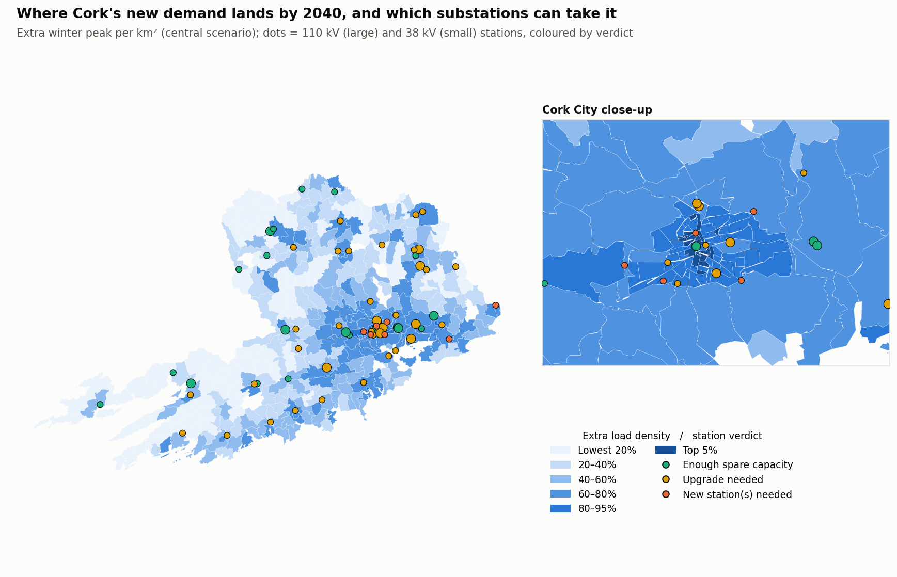

# Cork & Dublin 2040: How Much Power, How Many Substations, What Budget?

A network-planning model for **Co. Cork and County Dublin to 2040**, the year of ESB's Net Zero strategy. It
estimates how much electricity each county will need, maps where the new demand lands, tests it against every
ESB Networks 110 kV and 38 kV substation there, and sizes the stations and budget needed, with and without
flexibility. Dublin adds **data centres and other large energy users** as their own driver.

| | Report | Interactive map |
|---|---|---|
| **Cork** | [Cork 2040 report →](https://bymankirat.github.io/cork-2040-grid/) | [Cork capacity heatmap →](https://bymankirat.github.io/cork-2040-grid/map.html) |
| **Dublin** | [Dublin 2040 report →](https://bymankirat.github.io/cork-2040-grid/dublin/) | [Dublin capacity heatmap →](https://bymankirat.github.io/cork-2040-grid/dublin/map.html) |



> Independent analysis of public data. Not an ESB or ESB Networks publication.

## Questions answered

1. **How much power will each county need?** A bottom-up model built from CSO metered consumption and Census 2022
   data for every electoral division (heating fuel, cars, households). It adds housing growth, business growth,
   heat pumps, electric cars and new large loads, minus efficiency, year by year in three scenarios.
2. **Where?** Each electoral division's extra load is mapped and assigned to its nearest substation.
3. **Which substations run out, and when?** The new load is compared with each station's spare capacity, read
   automatically from ESB Networks' own workbooks. The result is cross-checked against ESB Networks' four official
   scenarios.
4. **How many stations, and what budget?** Stations needing an upgrade or new stations, costed with a 5,000-run
   Monte Carlo over demand, station sizes and unit costs, so results are ranges, not single numbers.
5. **How to accommodate it?** It shows how much smart EV charging, heat-pump flexibility and demand response save,
   and which drivers matter most (sensitivity).

## Run it

```bash
pip install -r requirements.txt
python run_pipeline.py                   # Cork: downloads CSO and ESB Networks data (first run a few minutes)
python run_pipeline.py --county dublin   # Dublin (report in docs/dublin/, tables in reports/dublin/)
python run_pipeline.py --county both     # both, with a Cork / Dublin switch in each report
python run_pipeline.py --demo            # simulated data, for testing only
python run_pipeline.py --refresh         # re-download when new data is published
python make_dashboard_data.py [--county dublin]   # tidy tables for a Tableau / Power BI dashboard
```

**Adding another county** is one entry in `REGIONS` in `src/config.py`: its CSO labels, how its electoral divisions
are named in Census 2022, growth assumptions and map settings.

**Dublin notes.** In CSO table MEC03, "Co. Dublin" excludes the city, so Dublin's consumption is Co. Dublin plus postal
districts Dublin 1–24. New data-centre and large-user load from 2025 (data centres used 23% of Ireland's metered electricity in 2025, CSO)
is modelled as a separate driver; it counts towards Dublin's peak but connect mostly to the transmission grid, so they are not assigned to
ESB Networks' distribution stations. Existing data-centre use is not split out of the CSO county figure.

Every assumption, with its source, is in `src/config.py`. Change one, re-run, and the report updates.

## Structure

```
run_pipeline.py     data -> checks -> 2040 scenarios -> Monte Carlo -> substations & budget -> charts -> report
src/config.py       data sources, regions (Cork, Dublin) and every planning assumption with its source
src/data.py         CSO consumption and Census tables, ED boundaries, ESB Networks workbooks
src/esbn.py         reads ESB Networks workbooks of unknown layout; Irish Transverse Mercator -> lat/lon
src/scenarios.py    bottom-up demand model by electoral division, S-curve uptake, Monte Carlo, sensitivity
src/planning.py     nearest-station assignment, upgrade/new-station decisions, costs, ESB Networks cross-check
src/quality.py      data checks
src/charts.py       figures (incl. county map with city close-up)
src/report.py       report page (docs/index.html)
src/webmap.py       interactive heatmap (docs/map.html): year slider, ESB Networks scenarios, 2040 verdicts
```

Data: CSO (CC BY 4.0) · ESB Networks
[Distribution Network Development Plan](https://www.esbnetworks.ie/services/tools-maps/distribution-network-development-plan).
Mankirat Singh · [Portfolio](https://bymankirat.github.io/myportfolio/) ·
[LinkedIn](https://linkedin.com/in/mankirat-singh-694440177)
