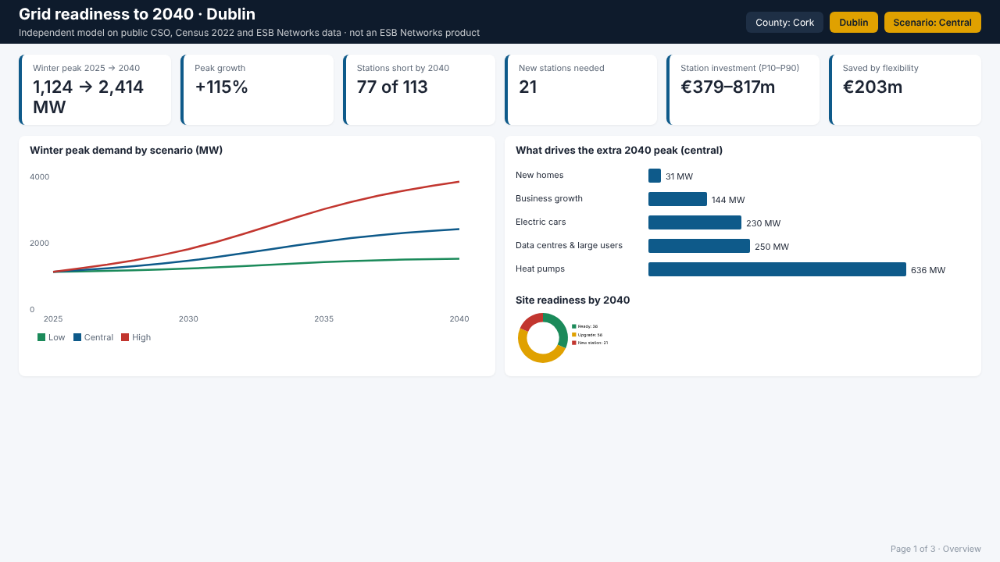
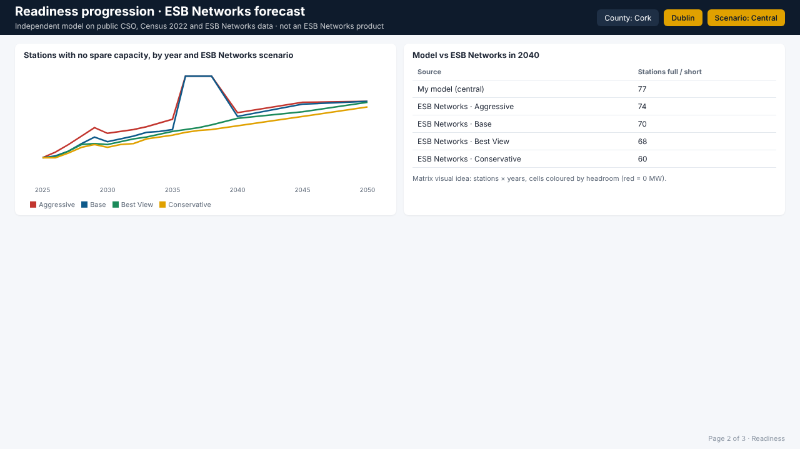
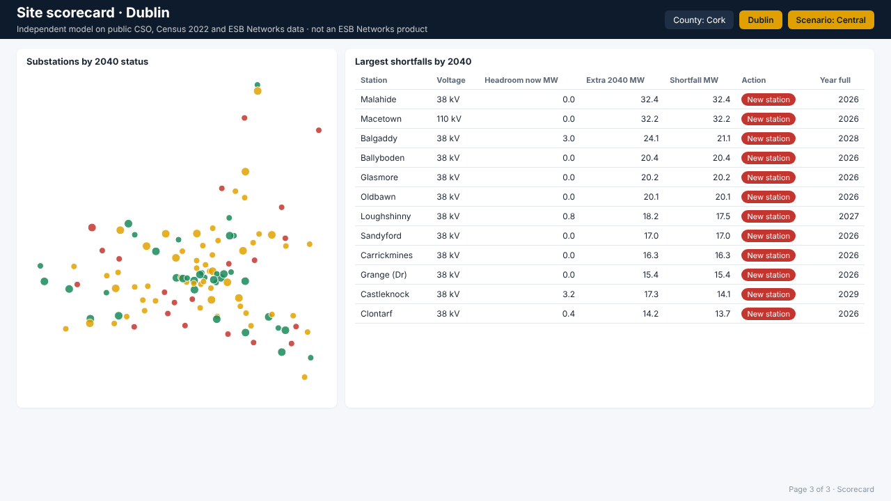

# Grid readiness dashboard (Power BI)

A three-page Power BI dashboard on top of my Cork and Dublin 2040 grid model: site readiness, readiness progression
against ESB Networks' own forecasts, and a site scorecard with red/amber/green status for 178 demand substations.

| Page | Question it answers |
|---|---|
| 1 Overview | How much will winter peak demand grow, what drives it, how many sites are ready, what will it cost? |
| 2 Readiness | Year by year, how many stations run out of spare capacity under each ESB Networks scenario, and how does my model compare? |
| 3 Scorecard | Which sites are short, by how much, from which year, and what action they need |

Target layout (Dublin selected):





## Data model (star schema)

```
dim_county ──┬── dim_station ─── fact_esbn_headroom ─── dim_year
             ├── fact_demand ──────────────────────────── dim_year
             └── fact_cost
```

| Table | Rows | Grain |
|---|---|---|
| `dim_station` | 178 | one demand substation: county, kV, location, headroom now, 2040 extra load, shortfall, action, RAG status, year full |
| `fact_esbn_headroom` | 12,104 | station × ESB Networks scenario × year: spare capacity (MW), `IsFull` flag |
| `fact_demand` | 576 | county × model scenario × year × driver: MW at winter peak |
| `fact_cost` | 6 | county × percentile (P10/P50/P90): station investment, with and without flexibility |
| `dim_year`, `dim_county` | 18, 2 | shared filters |

`python powerbi/build_data.py` rebuilds every CSV from the model outputs, so the dashboard is reproducible.

## Open it (5 minutes)

`pbip/` is a ready-made Power BI project: data, relationships, 27 measures with formats, theme and all three pages.
`python powerbi/build_pbip.py` regenerates it.

1. Download the repo (or the `pbip` folder) and open `pbip/Grid_Readiness.pbip` in Power BI Desktop.
2. When asked, click **Refresh now**. For `raw.githubusercontent.com` choose **Anonymous → Connect**
   (and **Ignore privacy levels** if asked). The tables load straight from the CSVs in this repo.
3. File → Save as → `grid_readiness.pbix` if you want a single file.

## Build it by hand (about 2–3 hours in Power BI Desktop)

**1. Load the data**
- Home → Get data → Text/CSV → load each file in `powerbi/data/` (Load, not Transform, except the next step).
- In Power Query (Home → Transform data), open `dim_station` and set `YearFull` to **Whole number** (empty = no shortfall). Close & Apply.

**2. Relationships** (Model view, drag column onto column; all single direction, one-to-many)
- `dim_county[County]` → `dim_station[County]`, `fact_demand[County]`, `fact_cost[County]`
- `dim_station[StationID]` → `fact_esbn_headroom[StationID]`
- `dim_year[Year]` → `fact_esbn_headroom[Year]`, `fact_demand[Year]`

**3. Measures**
- Home → Enter data → name the table `_Measures` → Load.
- Select `_Measures`, then Modeling → New measure, and paste each block from `measures.dax`.
- Format: percentages as %, MW with 0 decimals, € measures as currency.

**4. Theme**: View → Themes → Browse for themes → `theme/grid_readiness_theme.json`.

**5. Page 1 · Overview**
- Slicers: `dim_county[County]` (tiles, single select) and `fact_demand[Scenario]` (default Central).
- Cards: `Peak 2025 MW`, `Peak 2040 MW`, `Peak Growth %`, `Stations Short 2040`, `New Stations Needed`, `Cost Range`, `Flex Saving EURm`.
- Line chart: X `dim_year[Year]`, Y `Peak MW`, Legend `fact_demand[Scenario]` (clear the scenario slicer's effect on it: Format → Edit interactions → None).
- Bar chart: Y `fact_demand[Driver]`, X `Extra Demand MW`; filter Year = 2040 and Driver is not "Existing demand".
- Donut: Legend `dim_station[Status2040]`, Values `Stations`; colours Green/Amber/Red.
- Title text box bound to the `Page Title` measure (Format → Title → fx).

**6. Page 2 · Readiness**
- Slicer: `fact_esbn_headroom[Scenario]` (multi-select).
- Line chart: X `dim_year[Year]`, Y `ESBN Stations Full`, Legend `fact_esbn_headroom[Scenario]`.
- Matrix: Rows `dim_station[Station]`, Columns `dim_year[Year]`, Values `ESBN Headroom MW`; Conditional formatting → Background colour → gradient red (0) to green.
- Card or table comparing `Stations Short 2040` (model) with `ESBN Stations Full` at 2040.

**7. Page 3 · Scorecard**
- Map (or Azure Maps): Latitude/Longitude from `dim_station`, Legend `Status2040`, Size `Shortfall 2040 MW`.
- Table: Station, VoltageKV, HeadroomNowMW, Extra2040MW, Shortfall2040MW, Action2040, YearFull; sort by shortfall.
  Conditional formatting on Action2040 → Background colour → Field value → `Status Colour`.
- Slicers: VoltageKV, Action2040. Add a drill-through from the table to a station detail page if you want a fourth page.

**8. Finish**
- File → Export → Export to PDF, and take a screenshot of each page for the portfolio.
- Save as `grid_readiness.pbix` and add it to this folder.

## Notes worth mentioning in an interview

- **Percentiles do not add up.** Cork's P90 cost plus Dublin's P90 is not the P90 for both, so the cost measures only show a value when one county is selected.
- **Two sources, two scenario sets.** ESB Networks' four scenarios and my model's three are kept in separate tables rather than forced into one.
- **Model vs operator.** ESB Networks' forecasts show 86–107 stations full by 2040 across both counties; my central case finds 122 short because it follows the faster heat-pump and EV uptake of the net-zero path and cannot see reinforcements already planned.

Independent analysis on public CSO, Census 2022 and ESB Networks data; not an ESB Networks product.
